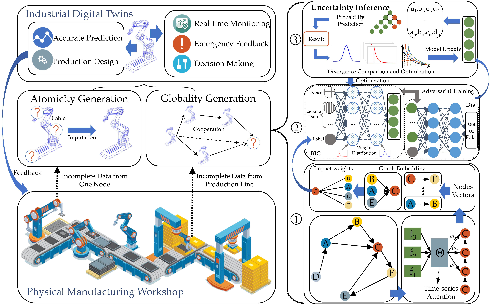

# High-Fidelity Digital Twin Construction  Under Incomplete Measurements

## Abstract
Owing to the real-time replication, analytical prediction, and solution feedback capacities, Digital Twin (DT) is recognized as the key paradigm to enable resilient production. In the industrial scenario, complete real-time data acquisition is usually constrained by limited measurement capacity or excessive transmission latency, thereby affecting the performance of real-time replication, i.e., the fidelity of DT. Therefore, this study focuses on exploring the incomplete data problem arising in the DT construction process in industrial scenarios. To compensate for the data incompleteness, we propose the REaL-time uncertAinTy infErence (RELATE) framework, which resolves the mentioned issue by integrating real-time data generation and uncertainty inference functions. The data generation method includes an improved temporal graph neural algorithm, namely Double-Dimension Graph Network (DDGN), to achieve real-time analysis of production states from both temporal and spatial dimensions. DDGN aims to extract features of production topology while guiding subsequent data generation. During the generation process, we design a Bayesian Inference Generator (BIG) by imitating the training process of Generative Adversarial Networks (GAN) to realize the unmeasurable data inference and generation. Finally, extensive experiments are conducted to validate the effectiveness of RELATE in data generation, as well as the topology identification of DDGN and the inference capacity of BIG.

## RELATE Framework Figure

## How to run the code?
The required packages can be installed directly by the env.yaml file.

BIG code: `BIG_Network.py` and `BIG_Training.py`

DDGN code: `DDGN.py` and `GNN_Network.py`

The data can be found in

 - https://www.kaggle.com/datasets/ramyharik/ff-2023-12-12-analog-dataset 

 - https://www.kaggle.com/competitions/bosch-production-line-performance.

**Note:** Some personal infomation are deleted, please note these problems in running. 
